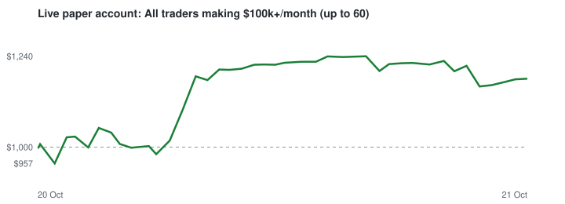
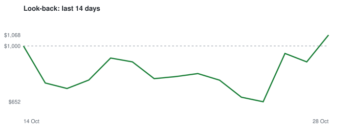
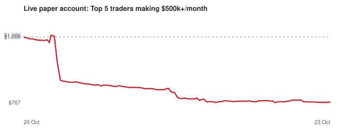
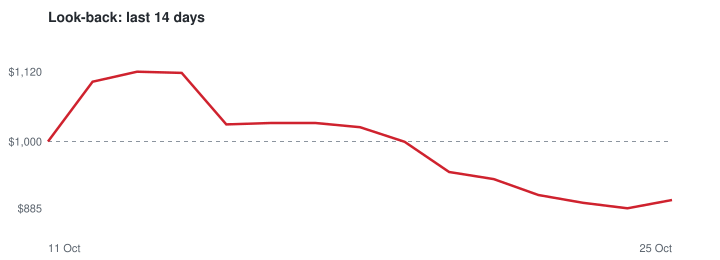

# Polymarket copy-trading bot (paper money)

Copies the trades of top Polymarket traders using a **fake $1,000.00 account** and real market prices. No real money, no wallet, no keys. Runs by itself every ~10 minutes on GitHub Actions.

## Head to head

| Strategy | Live account now | Live P/L | Live bets (won/finished) | Look-back 7d | Look-back 14d |
|---|---:|---:|---:|---:|---:|
| [All traders making $100k+/month (up to 60)](#wide) | $1,228.39 | +$228.39 (+22.8%) | 191 (60/122) | -$268.06 (-27%) | -$580.20 (-58%) |
| [Top 5 traders making $500k+/month](#top5) | $742.04 | -$257.96 (-25.8%) | 40 (4/13) | +$57.70 (+6%) | +$42.18 (+4%) |

## All traders making $100k+/month (up to 60)

### Live paper trading (fake money, real prices)

| | |
|---|---|
| **Account value** | **$1,228.39** (started with $1,000.00) |
| **Profit / loss** | **+$228.39 (+22.8%)** |
| Running for | 6.1 days (since 20 Oct 2026 18:24 UTC) |
| Test period | until 2026-11-30 - then no new bets; open ones are held until they settle |
| Last update | 26 Oct 2026 20:36 UTC ✅ |
| Cash / in open bets | $0.00 / $1,228.39 |
| Bets opened | 191 (69 still open) |
| Finished bets won / lost | 60 / 62 (49% win rate) |

#### Which traders are worth copying (live)

| Trader | Bets copied | Finished (won) | Profit/loss so far |
|---|---:|---:|---:|
| alwaysfade | 2 | 2 (1) | +$84.05 |
| OhWhenTheReds | 2 | 2 (2) | +$66.04 |
| takeormake | 6 | 6 (3) | +$57.73 |
| Bigggggggg | 3 | 2 (2) | +$46.11 |
| Elaran1993 | 2 | 2 (2) | +$42.29 |
| BreakTheBank | 6 | 3 (2) | +$33.07 |
| 0x446884aa55e3dCF7123D9A3D6243c4E34B70B165-1791060354625 | 2 | 2 (2) | +$29.80 |
| para-Vision | 1 | 1 (1) | +$28.58 |
| omnibus-076daa | 36 | 33 (15) | +$27.12 |
| ArielFilipino | 2 | 1 (1) | +$19.86 |
| donthackme | 15 | 7 (6) | +$18.77 |
| zerone777 | 10 | 2 (1) | +$18.43 |
| 0x448861155279dbf833d041b963e3ac854599e319 | 3 | 1 (1) | +$17.04 |
| Tokor | 1 | 1 (1) | +$7.20 |
| lfg100k | 1 | 1 (1) | +$6.12 |
| balthazar | 13 | 7 (4) | +$5.34 |
| paddaa | 2 | 2 (2) | +$2.30 |
| alex20011 | 14 | 6 (4) | +$2.16 |
| aenews2 | 1 | 0 (0) | -$0.61 |
| PiEDawg | 1 | 1 (0) | -$0.74 |
| THEHIGHLIFE | 1 | 1 (0) | -$1.02 |
| flawfence | 2 | 1 (0) | -$2.33 |
| VerilyWinningly | 4 | 3 (1) | -$2.99 |
| SpringlyFawl | 5 | 5 (0) | -$5.74 |
| e46m3 | 7 | 1 (1) | -$6.17 |
| PEYZ-BIGGEST-FAN | 4 | 4 (3) | -$7.59 |
| wan123 | 2 | 0 (0) | -$9.43 |
| Lucerys | 13 | 7 (3) | -$11.32 |
| 0xc7D02944A76B9F83B199e9090ECC92C82d241F8a-1776944395495 | 8 | 7 (0) | -$16.71 |
| HVAB | 2 | 2 (0) | -$19.15 |
| Mooseborzoiii | 1 | 1 (0) | -$20.20 |
| Wiretransferxyz | 2 | 2 (0) | -$40.40 |
| ic4cream | 3 | 3 (0) | -$60.60 |
| qwen4.1.fund | 14 | 3 (1) | -$78.65 |

**Currently copying 60 traders** (re-picked every 7 days, last on 20 Oct 2026 18:24 UTC): [joseph00677](https://polymarket.com/profile/0xcdcccd0f2d86e450d973da415ad2430e5cc7935a), [BreakTheBank](https://polymarket.com/profile/0xf0318c32136c2db7fec88b84869aee6a1106c80c), [e46m3](https://polymarket.com/profile/0x4f1d5ae26fc31472966e951af3183308736d8de2), [Diabolical-Prize](https://polymarket.com/profile/0x7c37b52eb226bcb9411375ec48b0169663fb6aeb), [Kch-Temp](https://polymarket.com/profile/0x924379a79c64b77ad5816ad362122a5f6228658e), [0x361b16e3ddfe1d415d41008daac2631d94ab74fe](https://polymarket.com/profile/0x361b16e3ddfe1d415d41008daac2631d94ab74fe), [omnibus-076daa](https://polymarket.com/profile/0x076daa87c4fe1a85402a9b6b8e0a866224388d4c), [Mooseborzoiii](https://polymarket.com/profile/0x57a85952044f2c8e4d31b475aab6987d2f98ebc2), [OhWhenTheReds](https://polymarket.com/profile/0x918b42a06ff25eaaa4a79eca9da6a9de46f4ea63), [primm](https://polymarket.com/profile/0xd38b71f3e8ed1af71983e5c309eac3dfa9b35029), [Bigggggggg](https://polymarket.com/profile/0x511f9c771449162349795d17becf8b37031acbe1), [takeormake](https://polymarket.com/profile/0xa38a455bbdd4b68486548b7e19da99903f4f821d), [juice-fruit](https://polymarket.com/profile/0x5fdd66ffd0325d4e8d1d86fbec50caa31770a747), [theowalcott](https://polymarket.com/profile/0x7ad71d79a3bb90d0a87a06500fa0fe11663842aa), [THEHIGHLIFE](https://polymarket.com/profile/0x8c0b024c17831a0dde038547b7e791ae6a0d7aa5), [Jsram](https://polymarket.com/profile/0x83720820a8aa6c3f20ad71850e7a1a17d16c5223), [donthackme](https://polymarket.com/profile/0x03805a13a0b3e058f55f6c6af95389d4f431073d), [dromedaryy](https://polymarket.com/profile/0x6575759174ad221bba9947bc3f18750ec769b198), [ic4cream](https://polymarket.com/profile/0x27f738fe203827445690339104aae35b20bc44b0), [para-Vision](https://polymarket.com/profile/0x676c1bb692c76b57b06f1b93817515acfa5ce139), [Dragon-Evolution](https://polymarket.com/profile/0x3eb31daa061a19855cbf0a4884c202fb86976a2a), [balthazar](https://polymarket.com/profile/0x5a218c7ad04135830a45c41aaed7294df7809318), [alwaysfade](https://polymarket.com/profile/0xe5b70fd855af9258d9463992e4f1ed7987905ee3), [Jokerxing7](https://polymarket.com/profile/0xe221be3b45dfe5ed562ee9dc16f47205728e06f6), [ArielFilipino](https://polymarket.com/profile/0xe18ecc345e00ee7c4f2d1f676f3dd2acb112f826), [PEYZ-BIGGEST-FAN](https://polymarket.com/profile/0xdaef2be2a19ad331737d06545f85615b094554e9), [MKSafe](https://polymarket.com/profile/0xb4164e085a0503532989d487c4b4b19f4288dd7b), [DelidelaDele](https://polymarket.com/profile/0x95c6c9a6727ed203e97230dda61ab19a020e1508), [KaneAnalytics](https://polymarket.com/profile/0x7e3a1f95c558f39a51ff334d789e3e039b553246), [alex20011](https://polymarket.com/profile/0x4868c31e81040e002b41984842b84bae8923a1c1), [Siddhartha1](https://polymarket.com/profile/0xc95ed399d2fbaec9461f2abd70e0d96df1921288), [paddaa](https://polymarket.com/profile/0x60a92c8620846d81f5ea17b0564e0d4b7c545a71), [Lucerys](https://polymarket.com/profile/0x1387d145aaf01f6e33b66525dda6e1f51f6955f8), [Tokor](https://polymarket.com/profile/0xa19cbababc312f9df185e49d7004c249ed1ade6b), [jonjones1993](https://polymarket.com/profile/0xce937f66d91dc6fd78e2b0e405f703a7d208ab2c), [0x30E4E574AF95340e873444bCa776d4D9372b8744-1770499771900](https://polymarket.com/profile/0xa2a78bb796f56b1b174b29eff72af4f0c558627b), [dsasdaas](https://polymarket.com/profile/0x1e52bbdf389526f57abc62641d518868f4c5eb43), [forgotmydinner](https://polymarket.com/profile/0x4a0eecbf4d18cb6b868f30a7b6e75b7905b9a4b1), [flawfence](https://polymarket.com/profile/0x23d81ba9371e576015c1e562db09c689f56b0288), [aenews2](https://polymarket.com/profile/0x44c1dfe43260c94ed4f1d00de2e1f80fb113ebc1), [0xc7D02944A76B9F83B199e9090ECC92C82d241F8a-1776944395495](https://polymarket.com/profile/0xc7d02944a76b9f83b199e9090ecc92c82d241f8a), [VerilyWinningly](https://polymarket.com/profile/0x6276ea490d6ca3a539f1d571a89d53d26e9f9db5), [0x446884aa55e3dCF7123D9A3D6243c4E34B70B165-1791060354625](https://polymarket.com/profile/0x446884aa55e3dcf7123d9a3d6243c4e34b70b165), [lfg100k](https://polymarket.com/profile/0xd3911bd5e070c9ad9a9519c966347802d8f3b109), [mde4life1986](https://polymarket.com/profile/0x54ce7dd357766fc3255645e55ef41edd51cc9f80), [zerone777](https://polymarket.com/profile/0xe949065b6c64308369c26dc590121623a5a4dea6), [qwen4.1.fund](https://polymarket.com/profile/0xb0c85813a7a4428f1139ff91d3118a92c391fe7f), [HVAB](https://polymarket.com/profile/0x8546a601f7c7cc3dae7141f20b0e09e42bbf35b8), [0x448861155279dbf833d041b963e3ac854599e319](https://polymarket.com/profile/0x448861155279dbf833d041b963e3ac854599e319), [wan123](https://polymarket.com/profile/0xde7be6d489bce070a959e0cb813128ae659b5f4b), [Elaran1993](https://polymarket.com/profile/0xb7271c112cbd83eb4c1ef1b554ff963604ae2a9d), [ColdBlooded](https://polymarket.com/profile/0xbcc321b6336117432f4e9d2d28b20d8b6795ac9c), [getbipped](https://polymarket.com/profile/0x252d7bae5ec87553dcafb23e275c202ac0d3c456), [Wiretransferxyz](https://polymarket.com/profile/0x30c7ac0158499ddc6761047f7f69bcf7d036ac3b), [SpringlyFawl](https://polymarket.com/profile/0xfbedb045813457be883ad83dd1078e88a2a1a665), [0x20D6436849F930584892730C7F96eBB2Ac763856-1768642056357](https://polymarket.com/profile/0x20d6436849f930584892730c7f96ebb2ac763856), [0x2cE8505aA641791EB8460f6ac6bf5C0511E34527-1746735481513](https://polymarket.com/profile/0x2ce8505aa641791eb8460f6ac6bf5c0511e34527), [robustmst](https://polymarket.com/profile/0xebfdb8164f0e0748818d6c7a9ac85a323267fd63), [PiEDawg](https://polymarket.com/profile/0xcf43b3b62f7881c831e2d2370b870f5e8a08b321), [LonnieHawkins](https://polymarket.com/profile/0xa797d6bd8fe6e404bb4d8e4ab3d97c38336fdede)

Leader trades we did <b>not</b> copy, and why

- leader trade too small / extreme price / crypto up-down: 118512
- per-market cap or out of cash: 14306
- market ends too soon: 6184
- signal too old (run was delayed): 219
- market already closed: 95
- price ran away from leader's price: 28
- order book too thin: 3

### Look-back test: if you had started copying 7 or 14 days ago

_Last calculated 26 Oct 2026 03:46 UTC. Copies each trade 20 min late, at a worse price (+0.01) and 1% fees._

| Started | Deposit | Value now | Profit/loss | Bets | Finished won / lost |
|---|---:|---:|---:|---:|---:|
| 7 days ago | $1,000.00 | $731.94 | **-$268.06 (-26.8%)** | 137 | 44 / 53 |
| 14 days ago | $1,000.00 | $419.80 | **-$580.20 (-58.0%)** | 127 | 45 / 56 |

| Trader | Bets | Profit/loss (14d) |
|---|---:|---:|
| 0xA0b86991c6218b36c1d19D4a29Eb0cE3606eB4 | 3 | +$92.25 |
| 0x448861155279dbf833d041b963e3ac854599e319 | 7 | +$34.33 |
| ArielFilipino | 2 | +$31.55 |
| Siddhartha1 | 2 | +$23.07 |
| theowalcott | 1 | +$20.20 |
| paddaa | 5 | -$1.46 |
| zerone777 | 3 | -$3.62 |
| 0x20D6436849F930584892730C7F96eBB2Ac763856-1768642056357 | 1 | -$5.72 |
| TheReturnOfDarthMaul | 3 | -$7.05 |
| VerilyWinningly | 2 | -$7.94 |
| kaxel78 | 1 | -$9.04 |
| WarriorH | 2 | -$14.42 |
| yabanci | 1 | -$14.45 |
| PEYZ-BIGGEST-FAN | 2 | -$16.98 |
| timetowander | 6 | -$22.20 |
| ic4cream | 12 | -$34.69 |
| scootergene | 4 | -$44.03 |
| ColdBlooded | 15 | -$67.23 |
| para-Vision | 10 | -$94.53 |
| 0x446884aa55e3dCF7123D9A3D6243c4E34B70B165-1791060354625 | 15 | -$95.71 |
| getbipped | 8 | -$150.60 |
| Tokor | 22 | -$191.92 |

> ⚠️ **This look-back is flattering.** Traders are picked from *today's* leaderboard, partly *because* their recent bets won. The live paper test above is the honest number - judge the strategy on that.

## Top 5 traders making $500k+/month

### Live paper trading (fake money, real prices)

| | |
|---|---|
| **Account value** | **$742.04** (started with $1,000.00) |
| **Profit / loss** | **-$257.96 (-25.8%)** |
| Running for | 6.1 days (since 20 Oct 2026 18:32 UTC) |
| Test period | until 2026-11-30 - then no new bets; open ones are held until they settle |
| Last update | 26 Oct 2026 20:37 UTC ✅ |
| Cash / in open bets | $0.36 / $741.68 |
| Bets opened | 40 (27 still open) |
| Finished bets won / lost | 4 / 9 (31% win rate) |

#### Which traders are worth copying (live)

| Trader | Bets copied | Finished (won) | Profit/loss so far |
|---|---:|---:|---:|
| e46m3 | 32 | 7 (3) | -$109.06 |
| BreakTheBank | 8 | 6 (1) | -$148.90 |

**Currently copying 5 traders** (re-picked every 7 days, last on 20 Oct 2026 18:32 UTC): [joseph00677](https://polymarket.com/profile/0xcdcccd0f2d86e450d973da415ad2430e5cc7935a), [BreakTheBank](https://polymarket.com/profile/0xf0318c32136c2db7fec88b84869aee6a1106c80c), [e46m3](https://polymarket.com/profile/0x4f1d5ae26fc31472966e951af3183308736d8de2), [Diabolical-Prize](https://polymarket.com/profile/0x7c37b52eb226bcb9411375ec48b0169663fb6aeb), [Kch-Temp](https://polymarket.com/profile/0x924379a79c64b77ad5816ad362122a5f6228658e)

Leader trades we did <b>not</b> copy, and why

- leader trade too small / extreme price / crypto up-down: 13768
- per-market cap or out of cash: 1106
- market ends too soon: 386
- signal too old (run was delayed): 28
- price ran away from leader's price: 1

### Look-back test: if you had started copying 7 or 14 days ago

_Last calculated 26 Oct 2026 04:04 UTC. Copies each trade 20 min late, at a worse price (+0.01) and 1% fees._

| Started | Deposit | Value now | Profit/loss | Bets | Finished won / lost |
|---|---:|---:|---:|---:|---:|
| 7 days ago | $1,000.00 | $1,057.70 | **+$57.70 (+5.8%)** | 40 | 1 / 4 |
| 14 days ago | $1,000.00 | $1,042.18 | **+$42.18 (+4.2%)** | 44 | 3 / 7 |

| Trader | Bets | Profit/loss (14d) |
|---|---:|---:|
| Bigggggggg | 35 | +$124.91 |
| BreakTheBank | 1 | -$0.95 |
| joseph00677 | 8 | -$81.78 |

> ⚠️ **This look-back is flattering.** Traders are picked from *today's* leaderboard, partly *because* their recent bets won. The live paper test above is the honest number - judge the strategy on that.

## Rules the bot follows

- Each strategy picks traders from the monthly leaderboard (All traders making $100k+/month (up to 60); Top 5 traders making $500k+/month) who are also profitable all-time, earn at least 3% on what they trade (filters out market-making bots) and made 3+ copyable trades in the last week. Re-picks weekly. Each strategy has its own separate fake account.
- When one of them buys ($100+, price between 0.05 and 0.95), the bot buys $20.00 of the same outcome at the real order-book price, max $60.00 per market.
- Skips it if the price has moved more than 0.03 past what the trader paid, if the market ends within 1h, or for 5/15-minute crypto 'Up or Down' markets (impossible to copy in time).
- Sells when the trader sells. Otherwise holds until the market resolves ($1 if right, $0 if wrong).
- Assumes 1% fees on every buy and sell (conservative).

Settings live in `config.json`. Raw data: `data/live_<strategy>_trades.csv`, `data/live_<strategy>_equity.csv`, `data/backtest_<strategy>.json`.

_Not financial advice. Past results, especially copied ones, don't guarantee future results._
