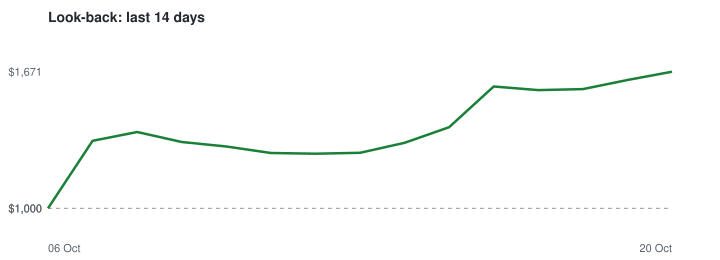

# Polymarket copy-trading bot (paper money)

Copies the trades of top Polymarket traders using a **fake $1,000.00 account** and real market prices. No real money, no wallet, no keys. Runs by itself every ~10 minutes on GitHub Actions.

## Live paper trading

_Not started yet. First run is due shortly._

## Look-back test: if you had started copying 7 or 14 days ago

_Last calculated 20 Oct 2026 17:41 UTC. Copies each trade 20 min late, at a worse price (+0.01) and 1% fees._

| Started | Deposit | Value now | Profit/loss | Bets | Finished won / lost |
|---|---:|---:|---:|---:|---:|
| 7 days ago | $1,000.00 | $534.43 | **-$465.57 (-46.6%)** | 89 | 27 / 39 |
| 14 days ago | $1,000.00 | $510.71 | **-$489.29 (-48.9%)** | 132 | 42 / 67 |

| Trader | Bets | Profit/loss (14d) |
|---|---:|---:|
| takeormake | 6 | +$1.41 |
| theowalcott | 4 | -$8.70 |
| Bigggggggg | 43 | -$38.54 |
| primm | 5 | -$113.83 |
| juice-fruit | 12 | -$122.84 |
| THEHIGHLIFE | 62 | -$206.80 |

> ⚠️ **This look-back is flattering.** Traders are picked from *today's* leaderboard, partly *because* their recent bets won. The live paper test above is the honest number - judge the strategy on that.

## Rules the bot follows

- Picks up to 60 traders on the monthly leaderboard who: made $100,000+ this month, are profitable all-time, earn at least 3% on what they trade (filters out market-making bots) and made 3+ copyable trades in the last week. Re-picks weekly.
- When one of them buys ($100+, price between 0.05 and 0.95), the bot buys $20.00 of the same outcome at the real order-book price, max $60.00 per market.
- Skips it if the price has moved more than 0.03 past what the trader paid, if the market ends within 1h, or for 5/15-minute crypto 'Up or Down' markets (impossible to copy in time).
- Sells when the trader sells. Otherwise holds until the market resolves ($1 if right, $0 if wrong).
- Assumes 1% fees on every buy and sell (conservative).

Settings live in `config.json`. Raw data: `data/live_trades.csv`, `data/live_equity.csv`, `data/backtest.json`.

_Not financial advice. Past results, especially copied ones, don't guarantee future results._
