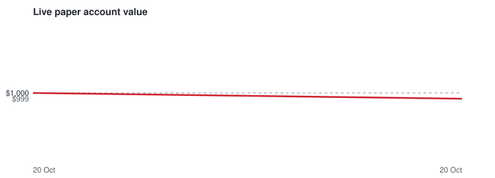

# Polymarket copy-trading bot (paper money)

Copies the trades of top Polymarket traders using a **fake $1,000.00 account** and real market prices. No real money, no wallet, no keys. Runs by itself every ~10 minutes on GitHub Actions.

## Live paper trading (fake money, real prices)

| | |
|---|---|
| **Account value** | **$1,000.00** (started with $1,000.00) |
| **Profit / loss** | **+$0.00 (+0.0%)** |
| Running for | 0.0 days (since 20 Oct 2026 17:37 UTC) |
| Test period | until 2026-11-30 - then no new bets; open ones are held until they settle |
| Last update | 20 Oct 2026 17:37 UTC ✅ |
| Cash / in open bets | $1,000.00 / $0.00 |
| Bets opened | 0 (0 still open) |
| Finished bets won / lost | 0 / 0 |

**Currently copying 15 traders** (re-picked every 7 days, last on 20 Oct 2026 17:37 UTC): [joseph00677](https://polymarket.com/profile/0xcdcccd0f2d86e450d973da415ad2430e5cc7935a), [BreakTheBank](https://polymarket.com/profile/0xf0318c32136c2db7fec88b84869aee6a1106c80c), [e46m3](https://polymarket.com/profile/0x4f1d5ae26fc31472966e951af3183308736d8de2), [Diabolical-Prize](https://polymarket.com/profile/0x7c37b52eb226bcb9411375ec48b0169663fb6aeb), [Kch-Temp](https://polymarket.com/profile/0x924379a79c64b77ad5816ad362122a5f6228658e), [0x361b16e3ddfe1d415d41008daac2631d94ab74fe](https://polymarket.com/profile/0x361b16e3ddfe1d415d41008daac2631d94ab74fe), [omnibus-076daa](https://polymarket.com/profile/0x076daa87c4fe1a85402a9b6b8e0a866224388d4c), [Mooseborzoiii](https://polymarket.com/profile/0x57a85952044f2c8e4d31b475aab6987d2f98ebc2), [OhWhenTheReds](https://polymarket.com/profile/0x918b42a06ff25eaaa4a79eca9da6a9de46f4ea63), [primm](https://polymarket.com/profile/0xd38b71f3e8ed1af71983e5c309eac3dfa9b35029), [Bigggggggg](https://polymarket.com/profile/0x511f9c771449162349795d17becf8b37031acbe1), [takeormake](https://polymarket.com/profile/0xa38a455bbdd4b68486548b7e19da99903f4f821d), [juice-fruit](https://polymarket.com/profile/0x5fdd66ffd0325d4e8d1d86fbec50caa31770a747), [theowalcott](https://polymarket.com/profile/0x7ad71d79a3bb90d0a87a06500fa0fe11663842aa), [THEHIGHLIFE](https://polymarket.com/profile/0x8c0b024c17831a0dde038547b7e791ae6a0d7aa5)

## Look-back test: if you had started copying 7 or 14 days ago

_Last calculated 20 Oct 2026 17:41 UTC. Copies each trade 20 min late, at a worse price (+0.01) and 1% fees._

| Started | Deposit | Value now | Profit/loss | Bets | Finished won / lost |
|---|---:|---:|---:|---:|---:|
| 7 days ago | $1,000.00 | $534.43 | **-$465.57 (-46.6%)** | 89 | 27 / 39 |
| 14 days ago | $1,000.00 | $510.71 | **-$489.29 (-48.9%)** | 132 | 42 / 67 |

| Trader | Bets | Profit/loss (14d) |
|---|---:|---:|
| takeormake | 6 | +$1.41 |
| theowalcott | 4 | -$8.70 |
| Bigggggggg | 43 | -$38.54 |
| primm | 5 | -$113.83 |
| juice-fruit | 12 | -$122.84 |
| THEHIGHLIFE | 62 | -$206.80 |

> ⚠️ **This look-back is flattering.** Traders are picked from *today's* leaderboard, partly *because* their recent bets won. The live paper test above is the honest number - judge the strategy on that.

## Rules the bot follows

- Picks the top 15 traders on the monthly leaderboard who: made $10,000+ this month, are profitable all-time, earn at least 3% on what they trade (filters out market-making bots) and made 3+ copyable trades in the last week. Re-picks weekly.
- When one of them buys ($100+, price between 0.05 and 0.95), the bot buys $20.00 of the same outcome at the real order-book price, max $60.00 per market.
- Skips it if the price has moved more than 0.03 past what the trader paid, if the market ends within 1h, or for 5/15-minute crypto 'Up or Down' markets (impossible to copy in time).
- Sells when the trader sells. Otherwise holds until the market resolves ($1 if right, $0 if wrong).
- Assumes 1% fees on every buy and sell (conservative).

Settings live in `config.json`. Raw data: `data/live_trades.csv`, `data/live_equity.csv`, `data/backtest.json`.

_Not financial advice. Past results, especially copied ones, don't guarantee future results._
